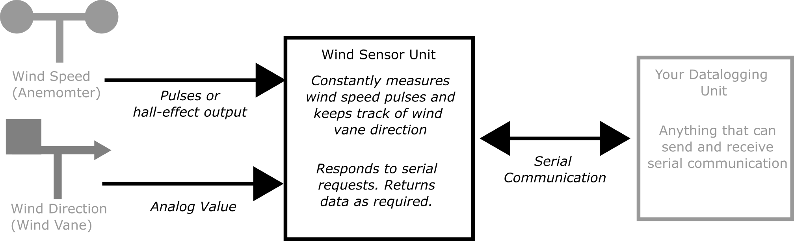
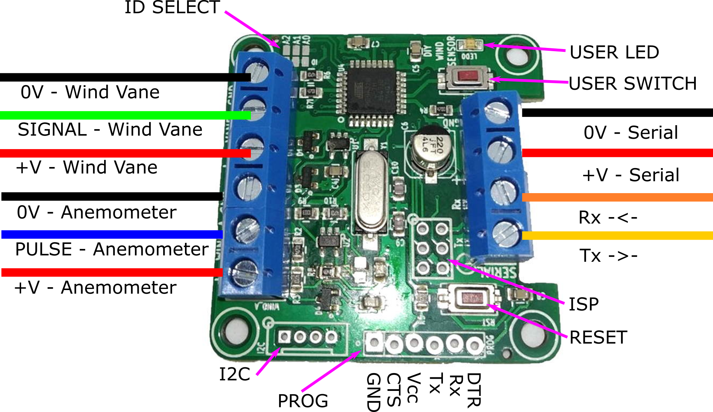

# WindSensor Overview
A DIY Wind sensor interface board.

This connects to various anemometers and wind vanes and provides a serial interface for averaged data from the pulses.

The problem with measuring wind anemometers and wind vane is that they constantly need to be checked. You need to know at all times when pulses have come in and which direction the wind vane is facing. This requires a bit of microcontroller time and processing. This unit is designed to solve that.
Wire up your vane and anemometer. Power the unit up. Then it will save the averaged data for you. You can then get hold of the data through serial requests and process as you need.

I wrote this to interface to an ESP32 data logger, which sleeps most of the time. It wakes up, talks to the wind sensor, gets the data it needs, then goes back to sleep, knowing the wind sensor is always monitoring.

It was designed as a relatively simple interface to remove the need for monitoring pulses and averaging them. 

## Wind Speed Measurements

The anemometer can either be a pulse output, NPN output or hall-effect output. The unit reads digital pulses, with circuitry on the unit converting the hall effect output to pulses. (Note: This unit cannot read 0-5V or analog output sensors).

The unit stores average wind speeds for 1 second, 10 second, 1 min, 10 min and 1 hour values. It also records the maximum and minimum wind speed.

The unit converts the pulses into a real wind speed using a y=mx+c linear conversion, where y is the wind speed and c is the number of pulses. m and c are stored in EEPROM and have default values of m=1 and c=0. These are floats and can be changed as required through the serial interface. Any updated values are stored in EEPROM. If the pulses are zero then the output is also zero (no matter what the y=mc+c function is). This stops a reading of 'c' when the pulse data is zero.

## Wind Vane Measurements

The wind vane input is analog. 

This can read either resistive wiper vanes or stepped resistive vanes. 

The stepped rsistive vanes have magnet reed switches which switch in and out different resistances. 
The resistance then tells us the direction. A pull up reistor is required in these situations.

The wind vane input can be 'trained'. So put the unit into vane training mode via the serial interface. This will run through N, NE, E, SE, S, SW, W, NW and you can hold the unit in the correct direction position and press the switch to store that data to memory. Once trained then the unit creates a buffer zone around each of the values and within the zone then the unit will record the correct direction.

Wind direction is difficult to measure, as you cannot directly average the analog value (because of the 360 to 0 point where the analog value rolls around from 1024 back to 0 - this means an average of a unit pointing just off north (i.e. one reading of 0 and one reading of 360) will give an average of (360+0)/2 = 180, which is south and totally wrong!). 

This unit will record the number of seconds the vane has been pointing in a certain direction. This means a 'wind rose' can easily be created. This is stored and updated until it is directly reset. The unit will also return the instantaeous direction, if that is needed.

Note: there is a 3V3 zener diode on the input to the Wind Vane unit. If you power the device with 3.3V then this is no problem. If you power the device with 5V then you will need to ensure the voltage at VANE does not go above 3.3V or else it will be limited.

There are two mode of operation, depending upon your use case:

## Response Mode

In this mode then the unit responds to serial requests made. You ask the sensor for data and this is returned. It never sends anything unless asked. 

## Broadcast Mode

In this mode then the unit regularly sends data via the serial connunication. It will send the averaged data for (0) 1 second, (1) 10 second, (2) 1 min, (3) 10 min and (4) 1 hour averaged data. If this is set to (5) then the unit does not send any data. The send mdoe is stored in EEPROM, so it will start sending data again even if power is lost.

Boradcast mode works well if the logger is always listening and you only have one sensor in range. If more than one sensor is in range then the data will clash and potentially cause issues, in which case use Response mode.

The two modes work together - you can have the unit sending regular data and also responding to requests.

It runs on an ATMega328 running at 8MHz with selectable baud serial (up to 57600). It comes pre-programmed, but code can be uploaded via the Arduino IDE, using the MiniCore board add-on. See firmware for more details.

# Hardware

The PCB was designed in KiCAD and is available here. A small PCB has been designed.
There is one reset switch, one user input switch and one LED output.

Both inputs for the wind vane and anemometer are buffered with an op-amp and also have 5.1V zener protection. The anemometer input compares the input with a low voltage level to create a pulse from a hall-effect (which output a sine-wave like signal). This also works as a pull-down pulse sensor, which works with NPN and switch output anemometers.

## Anemometers Tested:

Anemometer Name      | Link   | Type   | m Value   | c Value
---------------------|----------|---------|----------|----------
Vector Insrutments NRG #40C | https://www.nrgsystems.com/products/met-sensors/detail/40c-anemometer | Hall-effect  | 0.765 for m/s | 0.35 for m/s
Maplin Anemometer (low cost) | https://www.ebay.co.uk/itm/274338314354 | Reed-switch pulse | 0.7 for m/s | 0 for m/s
AliExpress Unit (low cost) PR-3000-FS-NPN| https://www.aliexpress.com/item/32798148991.html | NPN Pulse | |

## Wind Vanes Tested:

Wind Vane Name      |   Link   |  Type
---------------------|----------|-----------
Maplin Vane | No Link |  Switched resistive

## Board ID Number

Each unit can have a unique ID (using a solder pad for 0-7 values), so multiple units can be added to a serial bus, if needed. The defalt is 0.

# Firmware

This uses an ATMega328 running at 8MHz with 3.3v or 5V supply.

The firmware used in this project is available in this github repository:

[https://github.com/curiouselectric/SensorInterfaceFirmware](https://github.com/curiouselectric/SensorInterfaceFirmware) 

Please follow the information within that repository for the serial commands and firmware information.

# Overview of Connections

